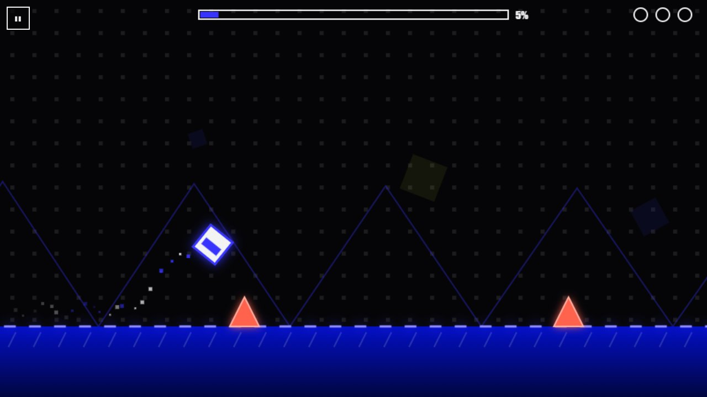
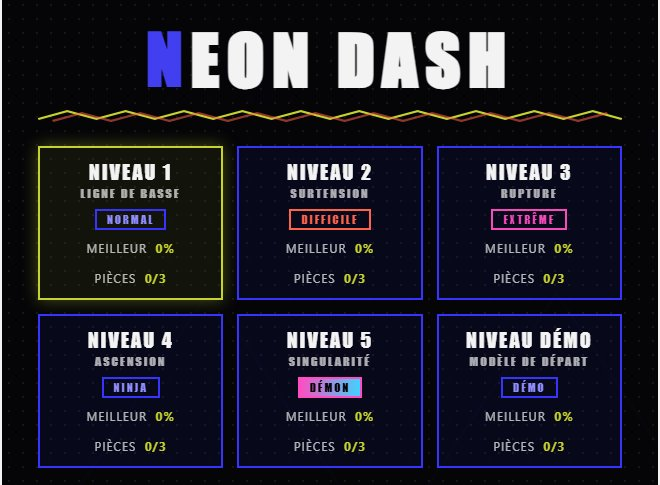

# NEON DASH — v1.3.1

**▶ Jouer en ligne : [neon.rvlts.com](https://neon.rvlts.com)** · par [John Dossin](https://dossin.rvlts.com)

| En partie | Sélection des niveaux |
|---|---|
|  |  |

Runner rythmé à un bouton, inspiré de Geometry Dash, avec **multijoueur temps réel**
(fantômes des autres joueurs + classement mondial), **éditeur de niveaux intégré**
et **système de trophées**.
Zéro dépendance : tout est dessiné en canvas/CSS/SVG, tout le son est synthétisé en
WebAudio, et le serveur WebSocket est écrit à la main sur les modules natifs de Node.

## Lancement

```bash
npm run dev
```

Puis ouvrir http://localhost:7100

Options : `npm run dev -- --port 1234 --host 127.0.0.1` (ou variables `PORT` / `HOST`).

Pour jouer à plusieurs : tout le monde ouvre la même adresse (même réseau local ou
serveur exposé) — la connexion multijoueur est automatique.

## Multijoueur (v1.1)

- **Pseudo** : champ sur l'écran titre (généré au premier lancement, ex. `JOUEUR-4821`),
  persisté en local, modifiable à tout moment (14 caractères max, A–Z 0–9 espace `_` `-`).
- **Fantômes en direct** : les autres joueurs connectés qui jouent le **même niveau**
  apparaissent sur le parcours en semi-transparence, chacun avec sa couleur néon et
  son **pseudo affiché au-dessus de la tête** (comme dans Roblox). Ils ne gênent
  jamais : aucune collision, le parcours reste 100 % le tien.
- **Barre de progression partagée** : des petits marqueurs colorés sur la barre du HUD
  montrent où en sont les autres joueurs du niveau en temps réel.
- **Statut en ligne** : pastille `EN LIGNE · N JOUEURS` / `HORS LIGNE` sur l'écran
  titre, reconnexion automatique si le serveur redémarre. Hors ligne, le jeu reste
  entièrement jouable en solo.
- **CLASSEMENT** (bouton sur l'écran titre) : top 10 mondial par niveau — pseudo, %,
  temps (si 100 %), pièces — navigable avec `‹ ›`, plus la liste des joueurs en ligne
  et le niveau qu'ils jouent. Ta ligne est surlignée. Échap ou FERMER pour quitter.
- **Scores** : envoyés automatiquement à chaque mort (meilleur %) et à chaque victoire
  (100 % + temps) en mode normal — jamais en entraînement ni en test éditeur. Le
  serveur garde **la meilleure marque par pseudo** (meilleur %, puis meilleur temps),
  persistée dans `scores.json`. L'écran de victoire affiche ton rang mondial.
- **Niveaux custom** : fantômes et classement partagés par **nom de niveau** — partage
  ton JSON, et ceux qui l'importent jouent sur le même tableau que toi. La démo a son
  propre tableau commun.
- **Protocole** : WebSocket sur `/ws` (même port que le site), messages JSON compacts
  (~15 états/s par joueur), implémentation RFC 6455 minimale côté serveur
  (`crypto`/`http` natifs, masquage, ping/pong, anti-flood, pseudos assainis).

## Niveaux

- **NIVEAU 1 — LIGNE DE BASSE** (NORMAL) : 140 BPM, 540 px/s, ~26 200 px.
- **NIVEAU 2 — SURTENSION** (DIFFICILE) : 160 BPM, 620 px/s, ~29 500 px.
  Portails de gravité (cube au plafond, flip en vaisseau), couloirs serrés.
- **NIVEAU 3 — RUPTURE** (EXTRÊME, v1.2) : 180 BPM, 700 px/s, ~30 400 px — le plus
  rapide du jeu, avec sa propre musique. Six sections : intro nerveuse, **couloir de
  scies** (au sol, flottantes, sur plateformes), **vaisseau avec double flip de
  gravité** et piliers, course au plafond à cadence rapide, **enchaînement de pads**
  au-dessus de triples pics, finale rythmique. Équité **prouvée par solveur** :
  recherche par faisceau sur la physique réelle du jeu (120 Hz), inputs limités à une
  cadence humaine (un changement max par 4 frames) — finissable et 3 pièces
  atteignables en une seule course.
- **NIVEAU 4 — ASCENSION** (NINJA) : 170 BPM, 560 px/s, ~9 800 px — parcours
  parkour : escalade de tours de blocs puis redescente.
- **NIVEAU 5 — SINGULARITÉ** (DÉMON, v1.3) : 150 BPM, **vitesse variable**
  (600 → 750 → 600 → 810 px/s), ~30 800 px (~45 s), sa propre musique (arpège filtré
  + caisse claire) qui **accélère avec les portails de vitesse**. Décor dédié : un trou
  noir qui grossit à mesure que tu avances, étoiles étirées en hypervitesse. Cinq
  sections annoncées à l'écran :
  1. **ÉVEIL** — orbes de saut (fosse de 9 pics infranchissable sans orbe, route haute
     facultative vers la pièce 1).
  2. **HYPERVITESSE ×1.25** — orbes de gravité : bascule au plafond pour éviter un sol
     piégé, puis retour au sol sous un plafond piégé.
  3. **MODE ONDE** — zigzag entre piliers espacés de 220 px, escalier à 45° dans un
     couloir de 160 px avec une encoche (pièce 2), puis **onde à gravité inversée**
     (maintenir = descendre). Assoupli en v1.3.1 (marge mini 80 px au lieu de 4 px).
  4. **SURCHAUFFE** — vaisseau et **scies mobiles** : ciseaux, slalom, fente entre
     piliers, pièce 3 au cœur de ciseaux qui s'ouvrent à ton passage.
  5. **SINGULARITÉ ×1.35** — chaîne d'orbes au-dessus d'une fosse de 21 pics, scie
     sauteuse, orbe de gravité, finale rythmique.

  Équité **prouvée par solveur** sur le vrai `game.js` (recherche par faisceau à 120 Hz,
  inputs limités à un changement par 4 frames, les 4 phases possibles) : finissable
  **et 3 pièces en une seule course** pour chaque phase ; orbe de la fosse vérifié
  obligatoire. Les scies mobiles sont calées sur l'horloge du niveau : comme la vitesse
  ne dépend pas des inputs, leur position au passage du joueur est toujours la même
  (apprenable, pas de hasard) — `addTimedSaw` règle leur phase pour la configuration
  voulue à l'arrivée.
- **NIVEAU DÉMO** (badge DÉMO) : niveau custom d'exemple (~13 000 px, difficulté
  facile) présent dès la première ouverture — jouable depuis le sélecteur et
  ouvrable dans l'éditeur comme modèle de départ. Si tu le modifies, ta version
  est conservée (jamais écrasée) ; si tu le supprimes, il ne revient pas tout
  seul — un bouton **« Réinitialiser la démo »** apparaît alors dans MES NIVEAUX.
- **Niveaux personnalisés** : créés dans l'éditeur, badge CUSTOM dans le sélecteur,
  meilleur % et pièces suivis comme les niveaux officiels.

## Nouvelles mécaniques (v1.3)

| Objet | Effet |
| --- | --- |
| **Portail onde** (rose) | Mode ONDE : diagonale à 45°, maintenir = monter, relâcher = descendre ; hitbox 18×18 ; glisse sur sol/plafond, meurt contre un mur. Traînée néon en zigzag. |
| **Orbe de saut** (jaune) | En cube, passer dessus bouton maintenu **ou** taper jusqu'à ~115 ms avant (tampon, pensé pour le tactile) = saut en plein air (une fois par tentative). |
| **Orbe de gravité** (cyan) | Idem, mais inverse la gravité (plafond ↔ sol). |
| **Portails de vitesse** | ×0.8 (cyan), ×1 (blanc), ×1.3 (ambre) — la musique change de tempo avec. Indicateur ×N dans le HUD. |
| **Scie mobile** (niveaux officiels) | Oscille verticalement, calée sur l'horloge du niveau (reprise correcte aux checkpoints). |

**Tactile (v1.3.1)** : une tape très brève compte toujours pour au moins un pas de physique ;
jouer à deux pouces ne coupe plus l'appui quand on lève un doigt (seul le dernier doigt relâche) ;
`touchcancel` relâche proprement. Équité tactile vérifiée par un solveur « tapes seules » (tapes de
50 ms) sur toutes les sections cube du niveau 5.

Fantômes multijoueur : forme « onde » et interpolation à la vitesse locale du parcours.

## Éditeur de niveaux

Bouton **ÉDITEUR** sur l'écran titre (desktop-first : souris + clavier recommandés ;
le jeu reste jouable au tactile, l'édition n'est pas prévue pour).

- **Palette** (barre gauche) : Pic, Pic plafond, Bloc, Pad, Pad plafond, Scie,
  Portail cube, Portail vaisseau, Gravité ↓ (normale), Gravité ↑ (inversée),
  Pièce (max 3), Porte d'arrivée (unique), **Orbe saut, Orbe gravité, Portail onde,
  Vitesse ×0.8 / ×1 / ×1.3** (v1.3), Gomme.
- **Placement** : clic gauche pose magnétisé à la grille 40 px (fantôme avant pose) ;
  glisser avec Bloc peint un rectangle, glisser avec Pic pose une rangée ;
  clic droit (ou Gomme) supprime ; survol = surbrillance.
- **Défilement** : molette, SHIFT+glisser, flèches ← →, barre de défilement.
- **Annuler/Rétablir** : Ctrl+Z / Ctrl+Y (100 pas), boutons ↺ ↻.
- **Barre du haut** : nom, vitesse (540/620), musique (140/160 BPM),
  ▶ TESTER, 💾 ENREGISTRER, MES NIVEAUX, ← MENU.
- **TESTER** : lance le niveau (pas d'entraînement) ; Échap ou « ← ÉDITEUR » revient
  à l'éditeur sans rien perdre. Refusé si le niveau est vide ; sans porte, le test
  finit 1500 px après le dernier objet. En test, records et pièces ne sont pas sauvegardés.
- **Plafond automatique** : solide et visible dans les sections vaisseau et à
  gravité inversée des niveaux custom.
- **MES NIVEAUX** : modifier, jouer, exporter (JSON copié + modale), supprimer,
  importer (validation stricte : types connus, coordonnées finies, blocs ≤ 2400 px,
  max 3 pièces, 1 porte, 2000 objets), réinitialiser la démo (si supprimée).

### Format JSON d'export

```json
{"v":1,"name":"MON NIVEAU","speed":540,"bpm":140,"objects":[
  {"t":"spike","x":2000,"y":444},
  {"t":"block","x":2400,"y":364,"w":120,"h":80},
  {"t":"portalShip","x":2800,"y":210},
  {"t":"coin","x":3000,"y":300},
  {"t":"gate","x":5000,"y":444}
]}
```

Types : `spike`, `spikeCeil`, `block`, `pad`, `padCeil`, `saw`, `portalCube`,
`portalShip`, `portalGravUp`, `portalGravDown`, `coin`, `gate`,
`orb`, `orbGrav`, `portalWave`, `speedSlow`, `speedNormal`, `speedFast` (v1.3, acceptés aussi
par le serveur pour les niveaux publics).

## Trophées

Bouton **TROPHÉES** sur l'écran titre : 13 badges à débloquer, avec date de
déblocage et statistiques (tentatives, sauts, morts, niveaux terminés x/6).
Chaque déblocage affiche une bannière toast en haut de l'écran avec son dédié.

| Trophée | Condition |
| --- | --- |
| PREMIERS PAS | Terminer le NIVEAU DÉMO |
| LIGNE DE BASSE | Terminer le niveau 1 |
| SURTENSION | Terminer le niveau 2 |
| RUPTURE | Terminer le niveau 3 |
| NINJA | Terminer le niveau 4 |
| SINGULARITÉ | Terminer le niveau 5 |
| SANS FAUTE | Terminer un niveau officiel sans mourir (1 tentative, mode normal) |
| COLLECTIONNEUR | Les 3 pièces d'un même niveau |
| CHASSEUR DE PIÈCES | 9 pièces cumulées |
| CRÉATEUR | Enregistrer un premier niveau (import inclus) |
| ARCHITECTE | Enregistrer un niveau de 60 objets ou plus |
| PERSÉVÉRANT | 100 tentatives au total |
| MARATHON | 5 000 sauts au total |

Les complétions (trophées de niveau) ne comptent qu'en mode normal —
jamais en entraînement ni en test éditeur.

## Contrôles (jeu)

| Entrée | Action |
| --- | --- |
| ESPACE / CLIC / TACTILE | Sauter (maintenir = re-saut ; en vaisseau : poussée) |
| ÉCHAP | Pause (ou retour éditeur en test) |
| M | Son on/off (persisté) |
| Z / X | Checkpoints (mode entraînement) |
| ‹ / › | Choisir le niveau (écran titre) |

## Mobile (v1.0)

- **Paysage recommandé** : en portrait sur appareil tactile, un overlay
  « TOURNEZ VOTRE APPAREIL » masque le jeu jusqu'à la rotation.
- **Plein écran** : bouton dédié en bas à droite (tactile uniquement) —
  entre/sort du plein écran via l'API Fullscreen, déclenché uniquement par un
  geste utilisateur. Recommandé sur téléphone pour masquer les barres du
  navigateur et gagner toute la hauteur utile.
- **Bord à bord** : `viewport-fit=cover` + prise en compte des zones sûres
  (`env(safe-area-inset-*)`) — le canvas va sous l'encoche en paysage, les
  boutons restent dans la zone sûre.
- **Dimensionnement** : le letterbox 960×540 est calculé sur la zone réellement
  visible (`visualViewport`, repli `window.innerWidth/innerHeight`), recalculé
  sur `resize`, `orientationchange` (avec recalculs différés pour iOS) et
  `visualViewport.resize` ; hauteur CSS en `100dvh` (repli `100vh`).
- **Menus** : panneaux scrollables (`max-height: 90dvh`) et version compacte
  automatique quand la hauteur passe sous 480 px (paysage de téléphone).

### Installer comme une app

Le jeu est une application web installable (manifest + meta iOS + icônes
générées en local, aucun asset externe). Servi en http(s) — c'est le cas via
`npm run dev` — l'ajout à l'écran d'accueil le lance **en plein écran, en
paysage, sans barres de navigateur**, comme une app native.

- **iOS (Safari)** : ouvrir le jeu dans Safari → bouton **Partager** →
  **« Sur l'écran d'accueil »**. L'icône NEON DASH lance le jeu en standalone
  (`apple-mobile-web-app-capable`, barre de statut `black-translucent`).
- **Android (Chrome)** : ouvrir le jeu → menu **⋮** → **« Installer
  l'application »** (ou « Ajouter à l'écran d'accueil »). Le manifest impose
  `display: standalone` + `orientation: landscape`, avec icônes standard et
  maskable (motif réduit à 70 % pour la zone sûre).

Fichiers : `manifest.webmanifest`, `icons/` (192/512 standard + maskable,
180 apple-touch-icon, favicon 32). Thème `#3834FF`, fond `#050508`.

## Persistance

`localStorage`, clé `neondash.v2` : records et pièces par niveau (officiels et
custom), compteurs totaux (tentatives, sauts, morts), trophées débloqués
(`trophies`, date ISO par badge), son, **pseudo multijoueur**, liste des niveaux
custom. Migration automatique depuis `neondash.v1` et ajout doux des champs
récents (`deaths`, `trophies`, `pseudo`) sur les anciennes sauvegardes v2.

Côté serveur : `scores.json` (créé automatiquement) — classement mondial par
niveau, meilleure marque par pseudo, 50 entrées max par tableau.

## Fichiers

- `index.html` — page unique (menus, éditeur, modales, trophées, classement en overlay DOM + canvas) + meta application web iOS/Android
- `style.css` — styles des menus, de l'éditeur, des trophées et du multijoueur
- `game.js` — moteur, niveaux (`LEVELS`), éditeur, audio, trophées (`TROPHIES`), client multijoueur (fantômes, classement)
- `server.js` — serveur statique **+ multijoueur** : WebSocket RFC 6455 écrit à la main (`/ws`), relais des positions, classement persisté (`scores.json`) — toujours zéro dépendance
- `scores.json` — classement mondial (créé par le serveur au premier score)
- `manifest.webmanifest` — installation Android/Chrome (standalone, paysage)
- `icons/` — icônes générées en local : 192/512 standard + maskable, 180 (apple-touch-icon), favicon 32
